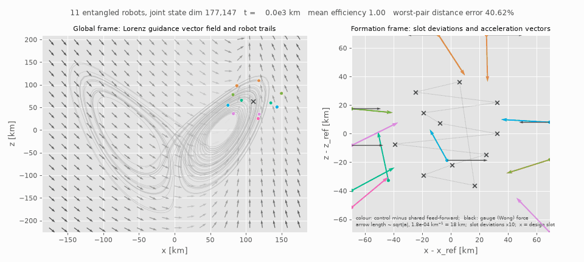

# qse3-sim

A working simulation of the QSE(3) framework: a nanoscale robot whose
configuration space is `Min(1,3) x SU(N)` instead of `SE(3)`, propagating under
neutrino-like physics.

Everything in the design document is implemented as executable code with real
numbers attached. The oscillation parameters, the Fermi constant and the MSW
potential are physical; the mass parameter `m`, the gauge couplings and the
matter profiles are free knobs of the model.



*Eleven entangled robots (a joint quantum state of 177,147 amplitudes)
following a chaotic Lorenz trajectory for 210,000 km.*

- **Left:** the Lorenz guidance vector field, sliced at the reference's current
  height, with each robot's trail.
- **Right:** the formation seen from the reference. Deviations from the design
  slots are magnified ×10. Each robot carries two vectors: its control
  correction (colour) and the gauge-field disturbance (black). They mostly
  point in opposite directions, which is the controller cancelling the field.

Rendered by `paper/make_gif.py`; `docs/swarm_R06.gif` shows six robots.

## Installation

Requires [uv](https://docs.astral.sh/uv/).

**macOS / Linux:**
```bash
curl -LsSf https://astral.sh/uv/install.sh | sh
cd qse3-sim
uv sync
uv run qse3-sim --help
```

Not hardened for Windows: the code itself is portable (pathlib, explicit
`encoding="utf-8"`, ASCII console output), but the install path has only been
exercised on macOS/Linux.

## Units

Natural units with `hbar = c = 1`, metric signature `(+,-,-,-)`:

| quantity | unit |
|---|---|
| length, coordinate time, proper time | km |
| energy, Hamiltonian, `A^a_mu` | km^-1 |
| field strength `F^a_mu nu` | km^-2 |
| mass parameter `m` | km^-1 |
| `I^a`, coupling `g` | dimensionless |

The conversion `1 eV^2 / GeV = 5.0677 km^-1` is what reproduces the standard
oscillation phase `1.267 dm^2 L / E`.

## What maps to what

| Document | Module | Implementation |
|---|---|---|
| `SU(N)` internal state space | `algebra.py` | generalized Gell-Mann basis, `Tr(T_a T_b) = d_ab/2`, structure constants from `[T_a,T_b] = i f^abc T_c` |
| Topological twist `alpha_i` | `algebra.py` | PMNS matrix (NuFIT normal ordering), DFT frame for `N != 3` |
| Matter refraction `a_i`, MSW | `physics.py` | `V = sqrt(2) G_F N_e`, computed from `G_F` and Avogadro rather than hardcoded |
| Joint phase `theta_i`, interval `d_i` | `kinematics.py` | one unitary per link, `A_i = e^{-i al_i T_tw} e^{-i(H_vac + a_i V) d_i} e^{-i th_i T_ph}` |
| Forward kinematics `P exp(...)` | `kinematics.py` | path-ordered product `U = A_n ... A_1` via `expm` |
| Geometric Jacobian, Fubini-Study | `kinematics.py` | quantum geometric tensor `Q_jk = <d_j psi|(1-P)|d_k psi>`; `Re Q` is the metric, `-2 Im Q` the Berry curvature |
| `Q_gauge`, non-Abelian Lorentz force | `dynamics.py` | `g I^a F^{a mu nu} u_nu`, with `F` built numerically from `A^a_mu` including the `-g f^abc A A` term (sign fixed by `H = +g A xdot T`, i.e. `D = d + igA`; see *Gauge sign fix*) |
| `Q_topological` | `dynamics.py` | matter as a refractive index, `M(x) = m + kappa <psi|H_mat|psi>` |
| Internal precession `dI^a/dtau` | `dynamics.py` | `I^a = <psi|T_a|psi>`, checked against the document\'s law to 1e-16 |
| Kinematic singularities | `singularity.py` | avoided crossings, adiabaticity `gamma`, Landau-Zener hopping |
| Control topology | `control.py` | damped least-squares inversion of the Fubini-Study Jacobian |
| Entangled swarm of R robots | `swarm.py` | joint state in `(C^N)^(x)R`, SU(N) exchange entangler, forces from reduced density matrices |
| Chaotic global trajectory | `swarm.py` | Lorenz guidance oscillator per robot, ring-coupled and pinned; conditional Lyapunov exponents |
| Swarm figures (ggplot style) | `swarm_plots.py` | ggplot2 `hue_pal()` palette, per-robot 3D Lyapunov phase diagrams |

## Commands

```bash
uv run qse3-sim verify          # conservation laws and consistency checks
uv run qse3-sim kinematics      # DH table -> U_total -> geometric Jacobian
uv run qse3-sim dynamics        # integrate the coupled system, write figures
uv run qse3-sim singularities   # find MSW resonance zones, quantify control loss
uv run qse3-sim control         # invert the Jacobian for an operator schedule
uv run qse3-sim swarm           # R entangled robots on a chaotic trajectory, in formation
```

Figures and a JSON summary land in `./qse3_output` (override with `--out`).

### Useful runs

```bash
# steer with a pure non-Abelian field (all field strength from the commutator)
uv run qse3-sim dynamics --gauge nonabelian-crossed --profile uniform

# matter waveguide: focusing acts only on the nu_e component
uv run qse3-sim dynamics --gauge off --profile waveguide \
    --offset-y 40 --topological-gain 5000 -L 4000

# sharp slab: non-adiabatic crossing, control is lost
uv run qse3-sim singularities -E 10 -p gaussian-slab -L 400

# stellar interior: the same crossing, now adiabatic
uv run qse3-sim singularities -E 10 -p stellar -L 15000000

# steer nu_mu -> nu_e with phase and twist commands only
uv run qse3-sim control --phase-gen 2 --twist-gen 5 --target 0

# the same request with generators that do not touch flavor 1: a hard wall
uv run qse3-sim control --phase-gen 3 --twist-gen 7 --target 0

# open it again by letting the environment coordinates move
uv run qse3-sim control --phase-gen 3 --twist-gen 7 --target 0 --actuation all
```

## Results worth knowing

**The document\'s precession law is exactly the Heisenberg equation for
`<T_a>`, but only in vacuum.** With `H_flavor` switched off,
`dI^a/dt = g f^abc A^b_mu xdot^mu I^c` reproduces `<psi|T_a|psi>` to 3e-16.
Switch the oscillation Hamiltonian back on and the two diverge by about 2e-2:
there is a flavor torque on the internal state that the gauge connection alone
does not account for. `verify` reports both numbers.

**The claim that the robot cannot torque without moving holds exactly.** Set
the 4-velocity to zero and `I^a` stays constant to 1e-9 no matter how strong
`A^a_mu` is, because the connection only ever appears contracted with
`xdot^mu`.

**The geometric Jacobian is structurally rank-deficient.** The 4-link chain has
16 joint coordinates, but the reachable state manifold is `CP^(N-1)`, of real
dimension `2(N-1) = 4`. The Fubini-Study metric therefore has rank at most 4 no
matter how many links you add: twelve joint directions do nothing. The chain is
massively redundant, which is good for singularity avoidance and bad if you
expected 16 independent controls.

**`Q_topological` is real but weak.** At `--topological-gain 1` the MSW gradient
force is about 3e-3 of the gauge force in the default scenario, and a
relativistic packet is stiff: transverse deflection scales as `1/(M gamma^2)`.
Visible matter steering needs a gain of order 1e3. That is an honest negative
result of the model rather than a bug, and the flag exists so the fictional
regime is entered deliberately.

**Singularities land where theory says they should.** For a 10 GeV packet the
code predicts an MSW resonance at 3.149 g/cm^3 and then locates the avoided
level crossing at 3.13 g/cm^3 purely from the eigenstructure. In the sharp slab
that crossing has `gamma = 0.002` and a hop probability of 0.997: the state does
not follow its instantaneous eigenvector, so commands issued in the eigenbasis
do the wrong thing. In a stellar density gradient the same crossing has
`gamma = 172` and steering stays faithful.

## The control law

`control` solves the inverse problem: given a target internal state, find a
schedule of joint coordinates that reaches it. The loop is resolved-rate
control with damped least squares,

```
dq = A^T (A A^T + lambda^2 I)^-1 e
```

where `A A^T` is exactly the Fubini-Study metric restricted to the actuated
coordinates. Four details matter and each one was found by watching the loop
fail without it:

- **Damping keyed to the smallest meaningful singular value.** `A` is always
  rank-deficient, since the chain has more joints than `CP^(N-1)` has
  dimensions. Keying the damping off `sigma_min` sees a structural zero at
  every configuration and clamps the loop permanently; it has to key off
  `sigma[2(N-1)-1]`.
- **Column scaling.** `theta` is in radians, `d` in km, `a` in g/cm^3. Without
  preconditioning the length coordinates take the whole step and the matter
  coordinates never move.
- **Per-coordinate trust region.** Ill-conditioned directions otherwise request
  phase excursions of order `1e10` rad. Numerically harmless, since the map is
  periodic, but useless as an operator schedule.
- **Global multi-start.** The map is periodic, so jittering the nominal pose
  never leaves its basin. Restarts resample each coordinate across its own
  range instead.

### What it found

Driving `nu_mu -> nu_e` with only the gauge coordinates (`theta` and `alpha`,
8 of 16 joints):

| phase / twist generators | result |
|---|---|
| `T_2`, `T_5` (touch flavor 1) | converged in 17 iterations, fidelity `1 - 1e-11` |
| `T_3`, `T_7` (leave flavor 1 alone) | stalls at fidelity 0.023, and stays there across 60 global restarts |

That second row is not a solver failure. The Fubini-Study metric is locally
full rank (4 of 4) at every configuration on the way, so local inversion always
reports a healthy Jacobian right up to the wall. The limit is global: `T_3` and
`T_7` are diagonal in, and rotate within, the `nu_mu`-`nu_tau` block, so the
only path into the `nu_e` sector is the small `theta_13` leakage inside the link
propagators. **Rank of the geometric Jacobian tells you nothing about
reachability.** For control-topology purposes the question is whether the
commanded generators plus the link Hamiltonians generate enough of `su(N)`.

Two ways to open the channel, both of which the solver finds on its own:

- Command a generator that touches the missing sector (`--phase-gen 2
  --twist-gen 5`), which is the clean answer: an 8-knob schedule, chain
  geometry untouched.
- Let the environment coordinates move (`--actuation all`). The solver then
  pushes the matter refraction `a_i` toward 6.8-8.7 g/cm^3, against an MSW
  resonance density of 7.87 g/cm^3 at 4 GeV, and lengthens the links. It
  rediscovers, from nothing but the Jacobian, that the way to steer into the
  electron sector is to route the robot through resonant-density matter.

The link bound matters too: at `--max-link 500` full actuation is still walled
at fidelity 0.16, because the links cannot accumulate enough oscillation phase.
At the 2000 km default it converges.

## Entangled swarm

`uv run qse3-sim swarm` flies R robots at once (default 6, a 729-dimensional
joint state) along a chaotic global trajectory while holding a rigid
formation. The code is in `swarm.py`, the figures in `swarm_plots.py`, and
the tests in `tests/test_swarm.py`.

### Entanglement, and why it changes the kinematics

The internal state is one vector in `C^N (x) ... (x) C^N`, not R separate
spinors. It evolves under the single-robot Hamiltonians plus a pair term

```
H_pair = sum_{r<s} w_rs  sum_a T_a^(r) T_a^(s),        sum_a T_a (x) T_a = SWAP/2 - 1/2N
w_rs   = exp(-|x_r - x_s| / ell) [ mu_ent + mu_nunu (1 - vhat_r . vhat_s) ]
```

The pair term is a flavor exchange. `mu_ent` is an engineered channel (the
robots generate entanglement on purpose). `mu_nunu` is the
neutrino-neutrino forward-scattering term, whose `(1 - cos theta)` factor comes
from collective neutrino oscillations.

An entangled robot has no state vector of its own, only a reduced density matrix
`rho_r`. Every force that moved the single robot is built from the internal
state, so each one is now read from `rho_r`:

- **Color charge:** `I_r^a = Tr(rho_r T_a)`, which enters the Wong force.
- **Refractive mass:** `M_r = m + kappa Tr(rho_r P_e) V`, which enters `Q_topological`.

For a pure robot `|I|` is fixed at `sqrt((N-1)/2N)`. Entanglement shrinks it.
The ratio `eta_r = |I_r| / |I|_pure` is the **actuation efficiency**: the same
field pushes an entangled robot less. This holds for the background field and
for the operator's steering field alike, because both act through the
charge.

A one-robot swarm reduces exactly to `QSE3Dynamics`: the test agrees to 1e-12.

### Control: two layers, each with an exact stability prediction

**Guidance (where the chaos is).** Each robot carries its own Lorenz
oscillator `s_r`. The oscillators are ring-coupled with gain `kappa_c`. The
anchor robots (1 and R/2+1) are also pinned to the global trajectory with
gain `kappa_p`. Robot r's slot is `L s_r + delta_r`, so two robots hold their
design distance exactly when their oscillators agree. Because the coupling is
the identity in state space, the Lyapunov analysis is exact:

- **Network transverse exponent:** `lambda_max(ref) - mu_min(kappa_c L + kappa_p P)`, which must be < 0.
- **Robot r's conditional exponent:** `lambda(s_r path) - m_r`, with `m_r = kappa_c deg_r + kappa_p P_r`.

**Mechanical tracking.** The tracking law is exact feed-forward of the slot,
PD feedback, distance-rigidity springs and velocity consensus. Its error
dynamics are linear time-invariant, and the slowest eigenvalue of
`closed_loop_matrix` is the predicted conditional exponent. The
**entanglement-aware** variant does two things:

- It gain-schedules by `1/eta_r`.
- It throttles `mu_ent` when `min eta_r` approaches `--eta-floor`.

The **naive** variant is the same law designed for a single pure robot.

**How the exponents are measured.**

- **Guidance layer:** tangent vectors along each oscillator path, renormalized every window.
- **Mechanical layer:** Benettin twin trajectories through the full entangled dynamics. The twins are driven (Pecora-Carroll) by the baseline `|Psi>`. The internal sector is unitary, so its perturbations never decay (exponent exactly 0). A free `|Psi>` perturbation would be inflated by every renormalization and would swamp the mechanical exponent.

### What the default run finds

Setup: 6 robots, SU(3), 4 GeV, helical gauge field. The Lorenz path is 25,538 km
of coordinate time, with the reference capped at 0.55c. Averages below are
taken over the settled part of each run (after its first third). `D(t)` is the
worst-pair relative distance error, and `<D>` is its time mean.

| layer | robots | measured | predicted |
|---|---|---|---|
| guidance (driven twins) | anchors 1, 4 | -4.86e-3 km^-1 | -4.87e-3 |
| guidance (driven twins) | followers 2, 3, 5, 6 | -1.90e-3 km^-1 | -1.91e-3 |
| tracking (Benettin twins) | all | -9.39e-3 km^-1 | -9.39e-3 |

The independent test of the synchronization proposition is the full,
undriven network: its slowest mode follows `exp(-mu_min t) Phi(t) a(0)` to
within 1.4% in amplitude (`paper/`, experiment E3). The sync margin is 2.59, and
the desync falls from 10 km to under 1e-3 km. Followers are locally unstable
3-4% of the settled time in this run, and 9% on average over ten attractor
segments (at most 16%). This happens on the lower arc of the large lobe, where
the Lorenz flow stretches faster than their 2e-3 km^-1 pull-back. Anchors never
are.

Over ten non-overlapping attractor segments (`<D>`, mean +/- sd):

| controller | `<D>` | eps (mean) |
|---|---|---|
| aware (gain scheduling + governor) | 0.27 +/- 0.07 % | 0.50 |
| gain scheduling only | 0.41 +/- 0.12 % | 0.40 |
| governor only | 0.85 +/- 0.20 % | 0.50 |
| naive | 1.41 +/- 0.38 % | 0.40 |
| unentangled | 0.51 +/- 0.11 % | 1.00 |

- **Gain scheduling removes the naive penalty.** At the same efficiency, it takes `<D>` from 1.41% to 0.41%.
- **The governor is what lets gain scheduling work fully.** It keeps every robot above the `eta_floor`. Without it, 83% of robots end below the floor, where the gain is capped.
- **With both, the entangled swarm beats the unentangled one in all 10 segments.** The ratio of their errors is close to the mean efficiency (0.51 vs 0.50). This "shielding" happens only because the disturbance acts through the same charge as the actuator. It fails once the actuator saturates: at `a_max = 2.5e-3` the entangled swarm loses formation.

The aware controller has an oracle view of `eta_r`, because it reads the exact
reduced state. `--cancel-forces` is a stronger oracle that also feeds the
physical forces forward.

**Model validity.** Forces are computed from each robot's reduced state, which
is mean-field (Ehrenfest). The quantum spread of the force exceeds its mean by
a median factor of about 5. Branches of a free wave packet would therefore
separate by 1 m within about 3 km of flight. The results hold for engineered
agents whose actuators respond to expectation values, not for free neutrino
wave packets. `paper/main.pdf`, section 8, has the analysis.

The margin is a real threshold. With 8 robots at `kappa_c = 6e-4`,
`kappa_p = 1.5e-3` it is 0.92. The transverse exponent is barely positive
(+1.7e-5 km^-1), so over one run the desync no longer decays: it stalls near
0.1 km, against 1e-3 km at the default gains. At margin 0.14 (`1e-4`, `2e-4`)
chaos wins outright. The oscillators drift 280 km apart, and inter-robot
distances end up more than 100 % off design.

### Useful swarm runs

```bash
uv run qse3-sim swarm --robots 8 --kappa-c 6e-4 --kappa-p 1.5e-3   # margin 0.92: desync stalls ~0.1 km
uv run qse3-sim swarm --robots 8 --kappa-c 1e-4 --kappa-p 2e-4     # margin 0.14: formation destroyed
uv run qse3-sim swarm --topology all                               # all-to-all guidance
uv run qse3-sim swarm --controller naive --no-compare              # the naive loop on its own
uv run qse3-sim swarm --mu-ent 5e-4                                # entangle faster
uv run qse3-sim swarm --robots 4 --no-twins --steps 1000           # quick look, ~15 s
```

Cost grows as `N^R`. The main run with twins integrates R+1 copies of the
swarm and takes about 5 minutes at the defaults; `--no-twins` skips the
mechanical twins. The joint state is capped at 60,000 amplitudes (R = 10 at
SU(3)).

### Figures (ggplot style)

Every figure uses matplotlib's `ggplot` style and ggplot2's own discrete
palette, `hue_pal()`, which the code computes from its HCL definition. Robot 1
of 2 is exactly `#F8766D`.

| file | shows |
|---|---|
| `swarm_lyapunov_phase3d.png` | one 3D panel per robot: its worldline coloured by its local conditional Lyapunov exponent |
| `swarm_lyapunov_sync3d.png` | the same exponent over each robot's synchronization-error phase space `L(s_r - s_ref)`, spiralling into the origin |
| `swarm_paths.png` | the swarm on the Lorenz path, and the formation seen from the reference frame |
| `swarm_dashboard.png` | formation error (3 runs), guidance desync, entanglement entropy, eta_r and throttle, running exponents, local stretching against each robot's pull-back |
| `swarm_flavor.png` | flavor content of each robot's reduced state |

## Scaling: 1 to 11 robots over a long horizon

`paper/scaling.py` repeats the swarm experiments for every size from R = 1 to
R = 11, over 40 Lorenz units (210,378 km, eight times the paper's E1 horizon).

**Why R = 11 is the limit.** The joint state has 3^R amplitudes, so cost grows
about as R^2 3^R. At R = 11 (177,147 amplitudes) one run takes about 170
minutes on two cores, and R = 12 would take about four times longer.

**Holding the synchronization margin fixed.** The guidance gains are rescaled
for every R so that the margin stays at 2.59. Without this, a two-anchor ring
loses synchronization as it grows; see below.

**Unentangled runs are cheap.** With the entangler off, each robot's state stays
a product state, so it is evolved robot by robot (3R amplitudes). A test checks
that this matches the full tensor evolution.

`<D>` is the time-mean worst-pair distance error after the transient, and eps
is the mean actuation efficiency.

| R | joint dim | `<D>` aware | `<D>` naive | `<D>` unentangled | eps aware | eps naive | run time (naive) |
|---|---|---|---|---|---|---|---|
| 1 | 3 | 0.00 % | 0.00 % | 0.00 % | 1.00 | 1.00 | 0 min |
| 2 | 9 | 0.10 % | 0.14 % | 0.14 % | 0.69 | 0.71 | 1 min |
| 3 | 27 | 0.12 % | 0.34 % | 0.24 % | 0.48 | 0.40 | 1 min |
| 4 | 81 | 0.11 % | 1.17 % | 0.27 % | 0.40 | 0.24 | 1 min |
| 5 | 243 | 0.12 % | 2.29 % | 0.30 % | 0.39 | 0.16 | 1 min |
| 6 | 729 | 0.16 % | 8.21 % | 0.32 % | 0.46 | 0.12 | 1 min |
| 7 | 2,187 | 0.15 % | 7.81 % | 0.33 % | 0.44 | 0.13 | 2 min |
| 8 | 6,561 | 0.16 % | 227.84 % | 0.34 % | 0.45 | 0.07 | 3 min |
| 9 | 19,683 | 0.17 % | 325.64 % | 0.37 % | 0.46 | 0.04 | 13 min |
| 10 | 59,049 | 0.16 % | 364.84 % | 0.38 % | 0.42 | 0.05 | 68 min |
| 11 | 177,147 | 0.17 % | 652.51 % | 0.39 % | 0.45 | 0.02 | 171 min |

- **The aware controller holds formation at every size** (0.10-0.17%) and beats
  the unentangled swarm at every R >= 2.
- **The naive controller degrades with swarm size and loses formation from
  R = 8 on.** Without the governor, entanglement keeps growing over the long
  horizon, so efficiency falls toward zero (0.02 at R = 11). The robots keep
  only a few percent of their actuation authority.
- **The ablations confirm the six-robot result.** Gain scheduling alone loses
  formation from R = 8. The governor alone holds formation (0.14-0.59%) but is
  always worse than both mechanisms together.
- **Exponents still match.** Guidance exponents measured by driven twins match
  the prediction to within 2.1% at every size. Mechanical exponents match to
  within 0.14% for 2 <= R <= 6.
- **The mean-field caveat holds at every size.** The median ratio of branch
  spread to mean force is 2.0 (R = 1) to 5.9.

**The guidance layer alone, which has no quantum cost, up to R = 32:**

- **Default gains, two anchors.** The ring synchronizes up to R = 10. It is
  marginal at R = 11 (margin 1.10, desync 0.19 km), and from R = 12, where the
  margin drops below 1, the robots end up hundreds of km apart.
- **Margin sweep.** The transition is sharp and identical for R = 4, 8, 11, 16
  and 32. At margin 1 every size ends 43-47 km out of sync; at margin 1.25 the
  desync is at most 0.11 km. Proposition 2 predicts exactly this: the threshold
  depends on the margin, not on R.

```bash
uv run python paper/scaling.py              # ~4.5 h on 2 cores (R = 11 dominates)
uv run python paper/scaling.py guidance     # guidance-only part, ~7 min
uv run python paper/make_scaling_figures.py # figures, table, numbers
uv run python paper/make_gif.py             # docs/swarm_R11.gif, docs/swarm_R06.gif
```


## Paper

`paper/` holds a LaTeX paper (`main.tex`, compiled `main.pdf`) with the full
mathematical development:

- the swap lemma
- efficiency as purity
- the synchronization and conditional-exponent propositions
- the tracking-exponent proposition
- the shielding scaling argument
- the mean-field validity analysis
- the scaling study to 11 robots (section 8)

Every number in it is a macro generated from the experiment data:

```bash
uv run python paper/experiments.py    # E1-E7, ~40 min on 2 cores -> paper/data/
uv run python paper/make_figures.py   # paper/figures/
uv run python paper/make_numbers.py   # paper/numbers.tex, paper/table_convergence.tex
cd paper && pdflatex main.tex && pdflatex main.tex
```

## Gauge sign fix

Earlier versions built the field strength as
`F = dA - dA + g f A A`. The internal Hamiltonian, however, uses `+g A xdot T`,
which corresponds to `D = d + igA` and requires `F = dA - dA - g f A A`. With
the old sign a pure-gauge potential had non-zero `F`, so the Wong force was not
gauge covariant. `physics.GaugeField.field_strength` now uses the covariant
sign. Two tests guard it: a pure-gauge potential has `F = 0`, and it transports
the internal state trivially around a closed loop.

What the fix touches:

- Fields whose `F` comes only from derivatives (chromomagnetic, chromoelectric)
  are unchanged.
- The commutator part of `nonabelian-crossed` and `helical` flips sign.
- All `verify` checks still pass.

## Conserved quantities

`verify` checks all of these:

| quantity | why it holds | residual |
|---|---|---|
| `<psi\|psi> = 1` | unitary evolution | 9e-16 |
| `u.u = 1` | every force is orthogonal to `u` by construction | 4e-14 |
| `I^a I^a = (N-1)/2N` | pure state in the fundamental rep | 4e-16 |
| `M u^0` | refractive energy, static profile at frozen flavor | 3e-12 |
| `f^abc` antisymmetry | Jacobi identity | 0 |

## Extending it

- `MATTER_PROFILES` and `GAUGE_FIELDS` in `physics.py` are plain dicts; a new
  entry is just a function from `x` to a value. Field strengths are
  differentiated numerically, so you never hand-derive `F^a_mu nu`.
- `--dof N` runs the whole pipeline at arbitrary `N`; the generator basis,
  structure constants and Casimir all generalize.
- The obvious next piece is a control law: invert the Fubini-Study metric to
  solve for the `A^a_mu` schedule that drives `|psi>` to a target state, with a
  damped-least-squares fallback near the singular zones that `singularities`
  locates.
